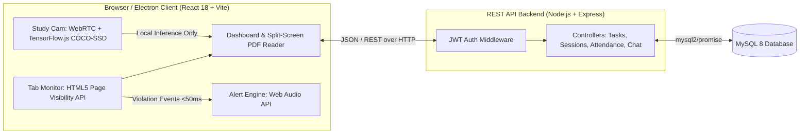
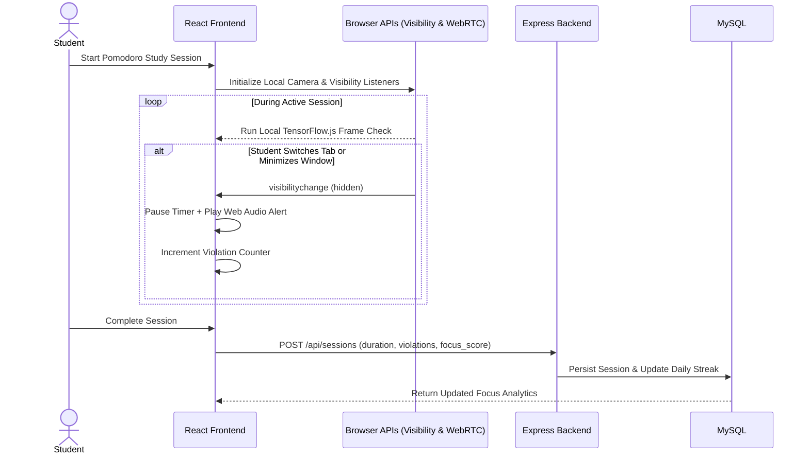
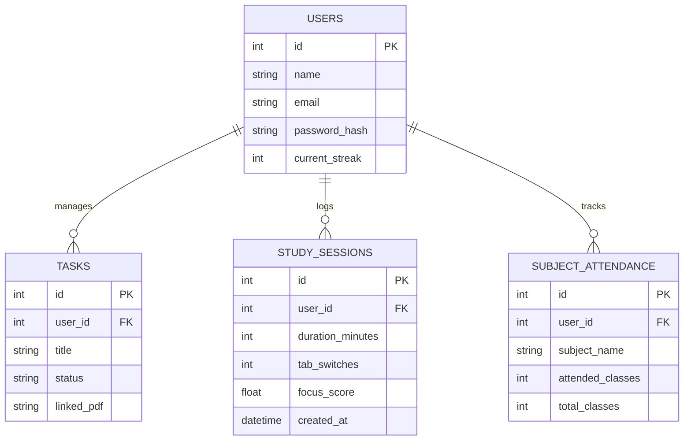

# FocusFlow AI

FocusFlow AI is a privacy-first, full-stack student productivity and focus companion built to keep study sessions, tasks, and class attendance in one unified workspace.

Most online study timers ignore whether you are actually working, while commercial proctoring tools stream webcam footage to external servers. We built FocusFlow to bridge that gap: it tracks focus in real time using client-side computer vision and browser visibility events, ensuring that zero video frames ever leave your machine.

---

## System Architecture

FocusFlow uses a decoupled client-server architecture where all heavy media and distraction processing happens directly inside the browser before lightweight session metrics are synced to the backend.



---

## Core Features

- **Privacy-First Study Camera (`WebRTC` + `TensorFlow.js`):** Renders your live camera feed and runs `COCO-SSD` object detection locally in the browser to verify presence and detect distractions without uploading video to any server.
- **Real-Time Tab-Switch Detection:** Listens to the HTML5 Page Visibility API to catch tab switches in under 50 ms, automatically pausing your Pomodoro timer, triggering a synthesized Web Audio API chime, and logging the distraction.
- **Dynamic Focus Score Engine:** Computes a live productivity score by weighing completed tasks, uninterrupted study sessions, tab-switch penalties, and subject attendance health.
- **75% Attendance & Bunk Manager:** Tracks subject-wise presents and absences with quick increment/decrement controls and highlights safe margins before your attendance drops below the mandatory 75% threshold.
- **Split-Screen PDF Reader:** Lets you read lecture notes and course PDFs side-by-side with your task list, automatically marking linked tasks complete once you scroll past 98% of the document.
- **Local Study Buddy Chatbot:** A lightweight, rule-based NLP chat drawer that queries your MySQL records to summarize pending tasks and safe bunk margins on demand.
- **Visual Analytics Dashboard:** Plots weekly study hours, focus trends, and subject-wise attendance breakdowns using Recharts.
- **Optional Electron Desktop Shell:** Wraps the web app into a standalone desktop window with process-level focus lockouts during active study blocks.

---

## Focus Session & Distraction Pipeline



---

## Tech Stack

- **Frontend:** React 18 (Vite), Tailwind CSS, Recharts, PDF.js, TensorFlow.js (`@tensorflow/tfjs`, `@tensorflow-models/coco-ssd`)
- **Browser APIs:** HTML5 Page Visibility API, Web Audio API, WebRTC / MediaDevices API
- **Backend:** Node.js, Express.js, JWT Authentication (`jsonwebtoken`), `bcryptjs`
- **Database:** MySQL 8 (`mysql2/promise`)
- **Desktop Wrapper:** Electron

---

## Database Schema Overview



---

## Project Structure

```text
focusflow-ai/
├── backend/
│   └── src/
│       ├── config/        # MySQL connection pool, schema.sql, and seed scripts
│       ├── controllers/   # Auth, tasks, attendance, sessions, insights, and chat logic
│       ├── middleware/    # JWT token verification middleware
│       ├── routes/        # Express REST API route definitions
│       └── utils/         # Streak calculation and helper functions
├── frontend/
│   └── src/
│       ├── components/    # Navbar, Sidebar, Clock, and Study Buddy Chat drawer
│       ├── context/       # Global AuthContext state provider
│       └── pages/         # Dashboard, Camera, Pomodoro, Attendance, DocumentReader, Analytics
├── main.js                # Electron desktop main process
└── preload.js             # Electron IPC preload bridge
```

---

## Getting Started

### Prerequisites

- Node.js (v18 or higher)
- MySQL Server (v8.0 or higher)

### 1. Clone the Repository

```bash
git clone https://github.com<your-username>/<your-repo-name>.git
cd focusflow-ai
```

### 2. Initialize the Database

Create a local MySQL database named `focusflow_db`, then import the schema and optional seed data:

```bash
mysql -u root -p focusflow_db < backend/src/config/schema.sql
node backend/src/config/seed.js
```

### 3. Configure and Start the Backend

```bash
cd backend
npm install
```

Create a `.env` file inside `backend/` with your local environment variables:

```env
PORT=5000
DB_HOST=localhost
DB_USER=root
DB_PASSWORD=your_mysql_password
DB_NAME=focusflow_db
JWT_SECRET=your_secret_key
```

Start the Express API server:

```bash
npm start
```

### 4. Start the Frontend

Open a separate terminal window:

```bash
cd frontend
npm install
npm run dev
```

Open the local development URL printed in your terminal (typically `http://localhost:5173`) to launch FocusFlow AI.

### 5. Optional: Run as an Electron Desktop App

From the root `focusflow-ai/` directory:

```bash
npm install
npm start
```

---

## Screenshots

> Add 3 to 4 screenshots of your Main Dashboard, Study Camera view, Attendance Manager, and Analytics charts here by dragging and dropping PNGs directly into GitHub's README editor.

---

## Contributors

- **Chirag Salecha**
- **Achyuth RH**
- **Adarsh MR**
- **Shridevi VD**

