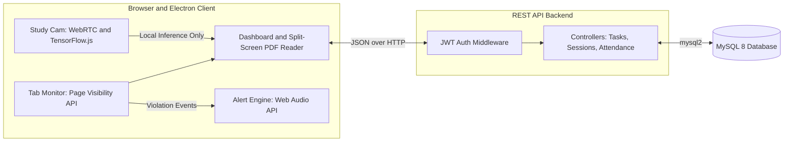
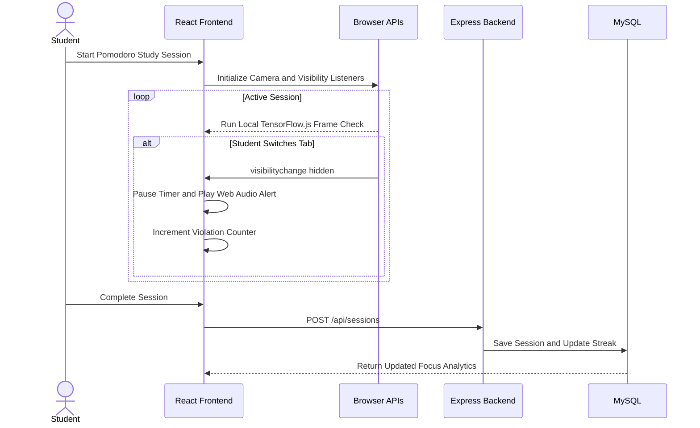
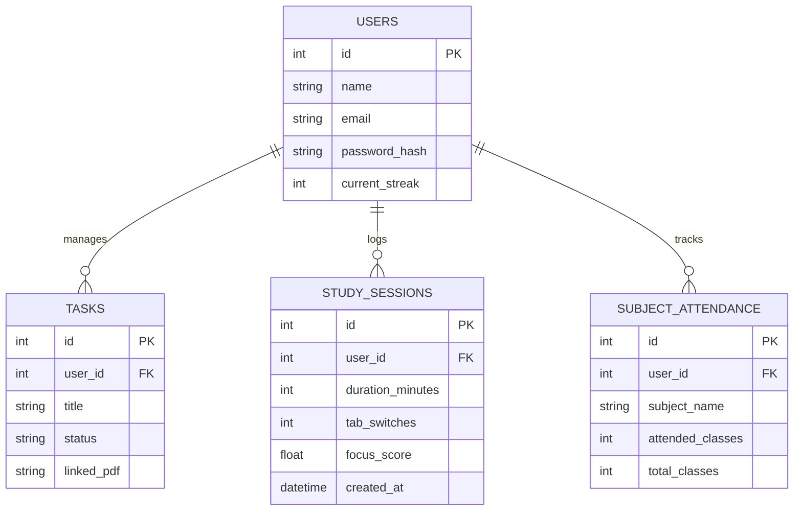

# FocusFlow AI

FocusFlow AI is a privacy-first, full-stack student productivity and focus management platform built to unify deep-work tracking, task management, document reading, and academic attendance in a single workspace.

Traditional study timers rely entirely on manual self-reporting and keep counting even when a user switches tabs or walks away from their desk. On the other hand, commercial exam-proctoring tools stream continuous webcam footage to external cloud servers, creating heavy bandwidth overhead and serious privacy concerns. FocusFlow AI solves both problems by executing computer vision inference and browser focus tracking entirely on the client device—ensuring that zero video frames or audio recordings ever leave the user's machine.

---

## Problem Statement and Design Philosophy

Students balancing coursework, coding projects, and exam preparation typically rely on fragmented tools: one app for to-do lists, another for Pomodoro timers, a PDF viewer for lecture notes, and spreadsheets or mental math to track mandatory 75% class attendance. Switching between these disconnected tools introduces friction and triggers frequent context-switching.

FocusFlow AI was engineered around three core principles:

1. **Zero-Upload Local Privacy:** All webcam frames and object detection models run directly inside the browser memory via WebRTC and TensorFlow.js. Only lightweight, numerical session summaries (such as duration, tab-switch counts, and computed focus scores) are transmitted to the backend.
2. **Real-Time Behavioral Accountability:** Instead of passive timers, the system actively monitors window visibility and presence during timed work blocks, providing immediate audio-visual feedback when attention drifts.
3. **Academic Context Awareness:** Productivity metrics are tied directly to real student constraints, linking reading tasks to course PDFs and factoring subject-wise attendance health into daily planning.

---

## System Architecture

FocusFlow AI follows a decoupled client-server architecture. The React client handles high-frequency UI updates, local machine learning inference, and browser event listeners, while the Node.js and Express REST API manages authentication, relational persistence, and analytical aggregations.



---

## Core Modules and Features

### 1. Privacy-First Study Camera (`WebRTC` + `TensorFlow.js`)
- Captures the local video stream using the browser `MediaDevices` API and runs a pre-trained `COCO-SSD` object detection model directly on the client GPU/CPU via `@tensorflow/tfjs`.
- Continuously verifies user presence and flags environmental distractions (such as mobile phones entering the frame or the user stepping away) in real time without storing or transmitting video frames.

### 2. Real-Time Tab-Switch and Focus Monitor
- Integrates the HTML5 **Page Visibility API** (`visibilitychange`) and window focus listeners to detect tab switches, window minimization, or context switches in under 50 milliseconds.
- Automatically pauses the active Pomodoro countdown upon detecting a distraction, logs a timestamped violation event, and synthesizes a non-intrusive acoustic chime using the native **Web Audio API** without external audio dependencies.

### 3. Dynamic Focus Score Engine
- Evaluates study quality beyond raw hours spent at a desk by computing a weighted **Focus Score** across four live signals:
  - Completed vs. pending daily tasks
  - Uninterrupted Pomodoro session duration
  - Tab-switch and webcam distraction penalties
  - Overall subject attendance standing

### 4. 75% Attendance and Safe Bunk Manager
- Designed around university attendance requirements, allowing students to log present and absent classes per subject with single-click increment/decrement controls.
- Dynamically calculates current attendance percentages, highlights subjects approaching the 75% cutoff, and computes the exact number of classes a student can safely miss—or must attend consecutively—to stay above the threshold.

### 5. Split-Screen PDF Document Reader
- Embeds a side-by-side workspace pairing a `PDF.js` document viewer with the active task queue so students can read lecture notes or research papers without leaving the app.
- Tracks reading scroll depth automatically and marks linked study tasks as completed once the user reaches 98% of the document.

### 6. Local Study Buddy Chatbot
- Provides an integrated, zero-latency conversational drawer powered by deterministic pattern matching and direct SQL queries.
- Answers natural-language prompts regarding pending deadlines, daily focus scores, and subject-wise attendance margins directly from the user's MySQL records without relying on external LLM APIs.

### 7. Visual Analytics and Streak Dashboard
- Aggregates historical study sessions into interactive weekly time-series charts, distraction frequency breakdowns, and subject attendance comparisons using **Recharts**.
- Maintains consecutive daily study streaks to reinforce long-term consistency.

### 8. Optional Electron Desktop Shell
- Wraps the React frontend inside a standalone **Electron** desktop container (`main.js` and `preload.js`) with IPC bridges for stricter desktop focus isolation during exam preparation.

---

## Focus Session and Distraction Pipeline



---

## Technology Stack

| Layer | Technologies Used |
| :--- | :--- |
| **Frontend Framework** | React 18 (Vite), Tailwind CSS, React Router, Context API |
| **Client-Side AI & Media** | TensorFlow.js (`@tensorflow/tfjs`), COCO-SSD, WebRTC (`MediaDevices`) |
| **Browser & Visualization APIs** | HTML5 Page Visibility API, Web Audio API, PDF.js, Recharts |
| **Backend Runtime & API** | Node.js, Express.js, RESTful JSON Architecture |
| **Authentication & Security** | JSON Web Tokens (`jsonwebtoken`), `bcryptjs` password hashing, CORS |
| **Database** | MySQL 8 (`mysql2/promise` connection pooling) |
| **Desktop Container** | Electron (`main.js`, `preload.js` IPC bridge) |

---

## Database Schema Overview



---

## Repository Structure

```text
focusflow-ai/
├── backend/
│   └── src/
│       ├── config/        # MySQL connection pool, schema.sql, and initial seed scripts
│       ├── controllers/   # Modular logic for auth, tasks, attendance, sessions, insights, and chat
│       ├── middleware/    # JWT token verification and request protection
│       ├── routes/        # Versioned REST API route definitions
│       └── utils/         # Study streak calculation and scoring helpers
├── frontend/
│   └── src/
│       ├── components/    # Reusable Navbar, Sidebar, live Clock, and Study Buddy Chat drawer
│       ├── context/       # Global AuthContext session state provider
│       └── pages/         # Dashboard, Study Cam, Pomodoro, Attendance, PDF Reader, and Analytics
├── main.js                # Electron desktop window lifecycle and focus management
└── preload.js             # Secure Electron contextBridge preload script
```

---

## API Endpoints Summary

- **`/api/auth`** — User registration, login, password hashing, and JWT session verification.
- **`/api/tasks`** — CRUD operations for daily study tasks, priority tagging, and PDF completion triggers.
- **`/api/sessions`** — Logging completed Pomodoro blocks, tab-switch violation counts, and daily streak updates.
- **`/api/attendance`** — Subject-level class tracking, 75% threshold calculations, and safe bunk projections.
- **`/api/insights`** — Aggregated metrics powering the Focus Score engine and Recharts analytics views.
- **`/api/chat`** — Query handler for the local Study Buddy assistant.

---

## Future Scope

- **Adaptive Break Scheduling** - Dynamically adjust Pomodoro work-to-rest intervals based on a user's historical distraction frequency across different times of the day.
- **Calendar and LMS Integration** - Sync assignment deadlines, exam schedules, and daily class timetables automatically from university portals or standard `.ics` calendar feeds.
- **Offline-First Session Sync** - Store active study timers, PDF reading progress, and attendance updates locally in `IndexedDB` when offline and sync seamlessly with MySQL once reconnected.
- **Custom Distraction Allowlists** - Let students whitelist specific research domains or documentation tabs during active study sessions so legitimate reference lookups do not trigger tab-switch penalties.
- **Peer Study Rooms** - Introduce opt-in, privacy-preserving study rooms where friends can share live Focus Scores and daily streak milestones without sharing webcam feeds.


